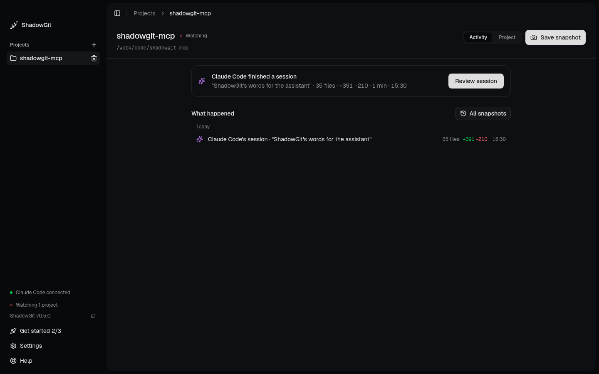

<Frame caption="Activity after Claude Code's session: the session waits for review, and what happened is listed below it">
  
</Frame>

**Activity** is where each project opens. The card at the top says what is happening now. Below it, **What happened** lists the project's sessions and snapshots, newest first, grouped by day. Activity and the rest of this page describe ShadowGit 0.5.0 and later.

## Add a project

Click **+** next to **Projects** in the sidebar, or **Add a project** in [Get started](/installation#get-started-in-the-app), and pick the project's folder. ShadowGit then:

- creates `.shadowgit.git` in the folder, which holds the snapshots, and adds it to the project's `.gitignore`;
- creates `.shadowgit-ignore`, listing what to leave out (see [Leave files out](#leave-files-out));
- takes the first snapshot of your project as it is.

Your own `.git` stays as it is. The first snapshot is never offered as a change to review: it's your project before ShadowGit, not something anyone changed.

## When ShadowGit takes a snapshot

Every 5 seconds ShadowGit looks for changed files. A change of 25 lines or more is saved at the next look. Smaller changes wait until at least 3 minutes have passed since the last snapshot, so a run of small edits lands in one snapshot. You can change these numbers in **Settings**, under **Watching** and **Snapshots**.

While your assistant's [session](/installation#sessions) is running, automatic snapshots pause for that project. Your assistant saves its work with a name as it goes, and the session's end takes whatever is left into one last snapshot.

## The card at the top

| The card says | When |
|---|---|
| ShadowGit is watching your project, with **See the project** | You've just added the project and nothing has changed yet |
| Claude Code is working, for how long, and that automatic snapshots are paused | A session is running |
| Claude Code finished a session, with its words, files, lines and time, and **Review session** | A session ended and you haven't marked it reviewed |
| Up to date, and the time of the last snapshot | Nothing waits for you |

On a project with snapshots and no session yet, **Up to date** adds how one gets there: "When your assistant works in webshop, its session shows up here." Until ShadowGit has heard from an assistant, **Connect your assistant** follows; after, "Ask it to start a ShadowGit session." If you used ShadowGit before 0.6.0 without connecting an assistant, a card above reads "Review what your assistant changes", with **Connect your assistant**, **See an example** and **Dismiss**.

The card names your assistant as ShadowGit hears it, or says "your assistant" when it doesn't know the name. **Review session** opens the session in [Review](/review). Once you mark it reviewed, the card moves on to the next session that waits, or says you're up to date.

## What happened

Each row is one thing that happened:

| Row | What it holds |
|---|---|
| Claude Code's session, with the words it started with | Every snapshot of the session, its own and the ones it saved. "working" while it runs, "no changes" when it ended with none |
| Your changes · 3 snapshots, 14:02–14:20 | A run of ShadowGit's automatic snapshots of your own edits, on one day and one sitting |
| Changes while your assistant was active | Automatic snapshots taken while ShadowGit noticed fast edits that looked like an assistant's, outside a session |
| You saved "Before the refactor" | A snapshot you saved with a name |
| Claude Code saved "Fixed auth bug" | A snapshot your assistant saved, with its name |

Click a row to open it in [Review](/review). A row's files, added and removed lines and time are on its right.

**All snapshots**, at the top right of What happened, lists every snapshot one by one, newest first, with sessions and days marking the way. Pick one to read it, or pick two to compare them.

## Save a snapshot

**Save snapshot**, at the top right, saves your changes now as one snapshot. To give it a name, open the "…" menu in Review, or the command palette (`⌘K`), and pick **Save snapshot with a name…**. The name is the snapshot's title in Activity and in Review. Saving is off while a session holds snapshots back.

## Restore a snapshot

Restore works on one snapshot. Open it from **All snapshots**, or click a saved snapshot's row, then pick **Restore this snapshot…** in Review's "…" menu or the command palette, and **Restore snapshot**. To undo a session, open All snapshots and pick the snapshot before it. ShadowGit:

1. saves changes not yet in a snapshot, leaving out the files in `.shadowgit-ignore`, as a backup snapshot named **Before restoring** and the snapshot's hash;
2. writes your files back as they were in that snapshot;
3. records the result, named **Restored** and the snapshot's hash.

Restore writes back the files the snapshot holds. Files you created after it stay in your folder, so delete them yourself if you want them gone. To undo a restore, restore the **Before restoring** snapshot.

Restore changes the files in your folder, never your own git history.

## Leave files out

`.shadowgit-ignore`, in the project's folder, lists what ShadowGit leaves out of its snapshots: dependency folders like `node_modules`, build output, logs, lockfiles, editor and system files. Edit it to leave out more, one pattern per line:

```text
# a folder and everything in it
coverage/**
# every file with this extension
*.sqlite
```

A line reads as in a `.gitignore`, except that a pattern matches at any depth unless it starts with `/`. `*` matches within one name, `**` across folders, `?` one character and `[ab]` one of those characters. A plain name such as `node_modules` leaves out a file or a folder of that name, and a line starting with `!` brings back a file an earlier line left out. New snapshots follow the file. The ones already taken keep what they hold.

From ShadowGit 0.6.0, git reads these rules itself, so it never opens a file they leave out: a file another program holds open in a left-out folder no longer stops snapshots. When ShadowGit can't read a file outside them, it names the file and asks you to add it here.

## Remove a project

Point at the project in the sidebar, click the trash icon, then **Remove project**. ShadowGit stops watching it and deletes:

- the `.shadowgit.git` folder, with every snapshot;
- the `.shadowgit-ignore` file;
- the `.shadowgit.git` line in `.gitignore`;
- the project's [map](/map).

Your files and your own git history stay as they are.
