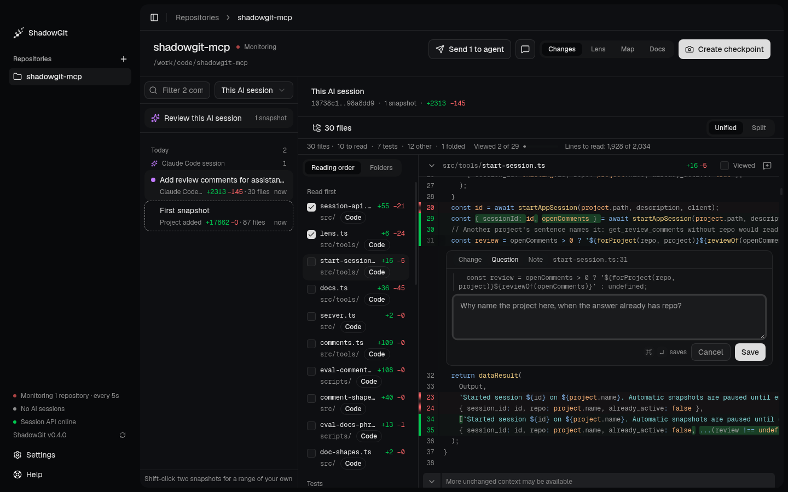
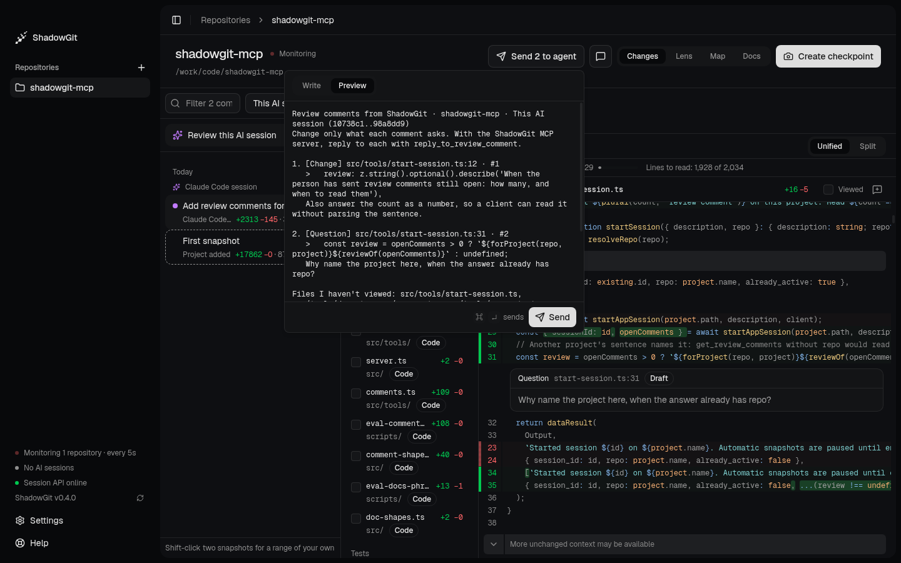
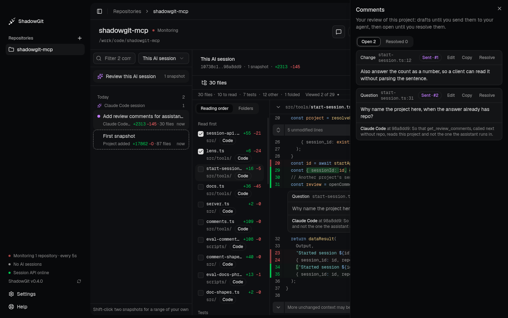

When you review a change in **Changes**, comments say what you want different. They stay drafts, seen only by you, until you send them. Your assistant then reads them, changes what each one asks, and replies under each. Only you close a comment.

<Frame caption="A question being written under line 31, with the line it quotes">
  
</Frame>

## Write a comment

1. Point at a line and click the **+** beside its number. For several lines, drag across them, or click their numbers, and press `C`. For a whole file, click the comment icon in the file's header.
2. Pick a tag: **Change**, the default, **Question** or **Note**. Your assistant reads the tag you set.
3. Write what you want, then click **Save** or press `⌘↵` (`Ctrl+Enter` on Windows and Linux).

A saved comment is a draft. It shows under its lines, and it stays after ShadowGit restarts. You can also comment on a step's code in the [Lens](/lens).

## Send them to your assistant

<Frame caption="The text your assistant gets, before you send it">
  
</Frame>

**Send 2 to agent**, at the top, counts your drafts. Click it to see them. **Preview** shows the exact text your assistant gets. Then click **Send**, or press `⌘↵`. ShadowGit:

- marks every draft sent, so your assistant can read them through the [ShadowGit MCP server](/installation);
- copies the text, so you can paste it into any assistant.

A Send takes every draft in the project, whichever range you wrote it on. The text names the project, and the range when you wrote every comment in it. Each comment gives its tag, its file and lines, the function or class around them, the lines it quotes and your words. The last line lists up to 20 files of the range you hadn't viewed, so your assistant doesn't take silence for approval:

```text
Review comments from ShadowGit · webshop · This AI session (8e6ec92..4f2a91c)
Change only what each comment asks. With the ShadowGit MCP server, reply to each with reply_to_review_comment.

1. [Change] src/sessions/store.ts:34-41 (SessionStore.find) · #12
   > const hit = cache.get(id)
   > if (!hit) return null
   Return the database row when the cache misses.

2. [Question] src/routes/login.ts:12 (login) · #13
   > res.cookie("sid", session.id)
   Why does the cookie have no expiry?

Files I haven't viewed: src/migrations/0004_sessions.sql, src/middleware/requireSession.ts
```

## Your assistant addresses them

Ask your assistant:

```text
Address my ShadowGit review comments
```

Or, as the message after a Send suggests:

```text
Read my review
```

Your assistant reads the comments you sent and haven't closed, and changes only what each one asks. A question gets an answer, and a note changes nothing unless its words ask for a change. For anything else, your assistant asks you first, and it replies to each comment once it's done.

When your assistant starts a session in the project, ShadowGit tells it how many comments are open. It reads them only when you ask, so an old comment never takes over a new task.

This needs the ShadowGit app 0.4.0 or later and version 2.7.0 or later of the MCP server.

## Replies and changes since

A reply shows under its comment, like "Claude Code at 9b1c2ab: Returned the row on a cache miss.", with a snapshot. During a session, that's the snapshot the session's checkpoint or end makes, which holds the change. Until then the reply reads "Claude Code, session in progress". Outside a session, it's the newest snapshot when the reply came. A reply never closes a comment.

When a later snapshot changes the lines a comment quotes, the comment says "Lines changed since, in 9b1c2ab". That's a fact about the lines, not a status. The comment stays open until you close it.

## The Comments panel

<Frame caption="Both comments, sent, with Claude Code's reply to the question">
  
</Frame>

`⇧C`, or the comment icon at the top, opens **Comments** beside the diff:

- **Open** lists your drafts and the comments you sent. **Resolved** lists the ones you closed.
- **Edit** changes a comment's words or tag, even once sent. Your assistant reads the words as they are now.
- **Copy** copies one comment's text.
- **Resolve** closes a sent comment, with **Undo** for a moment. **Open again** brings it back.

A comment shows under its lines when the range you're reading has those lines as the comment quotes them. The panel lists every comment, those on a whole file included.

## Where comments are kept

ShadowGit keeps comments, drafts included, in the project's `.shadowgit.git`, on your computer, never in your files or your own git history. Each comment has a number in its project, like #12, that you and your assistant can both use. A comment leaves your computer only through your own assistant.
