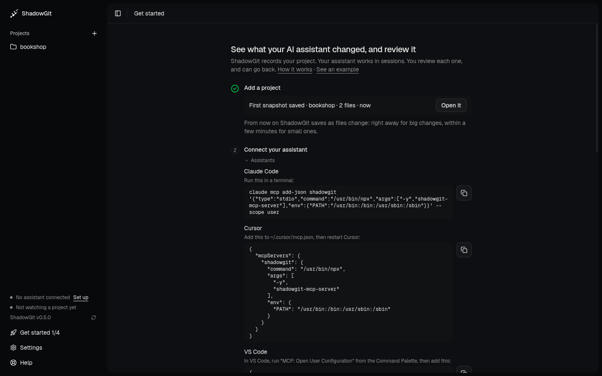
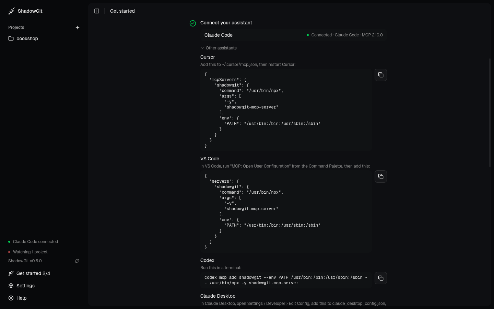
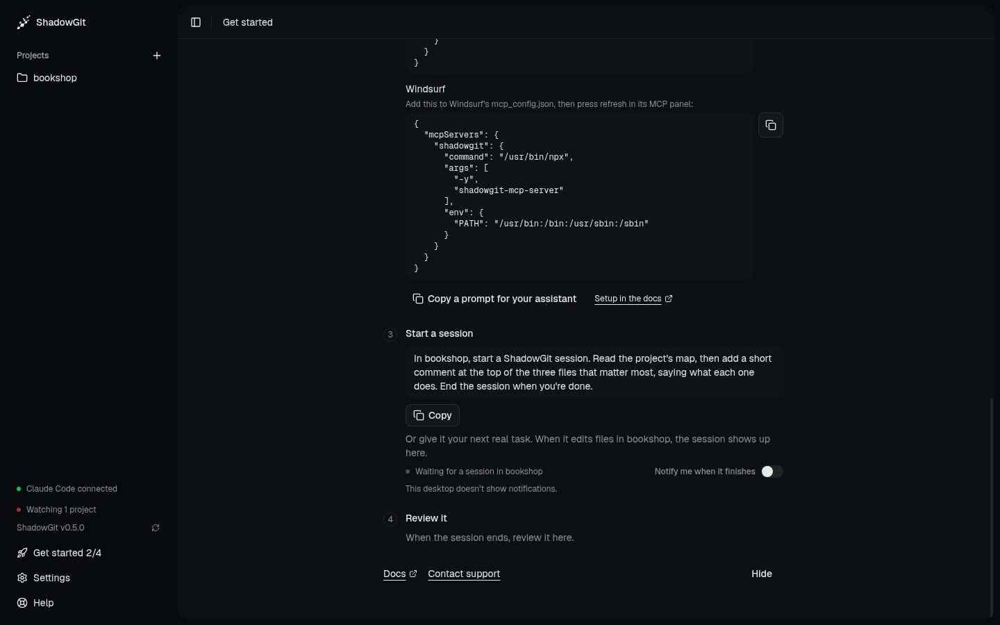
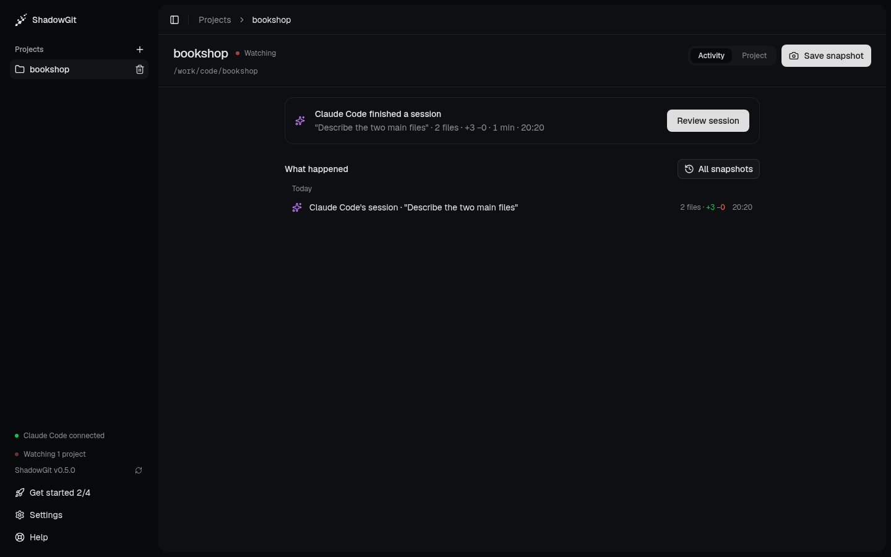
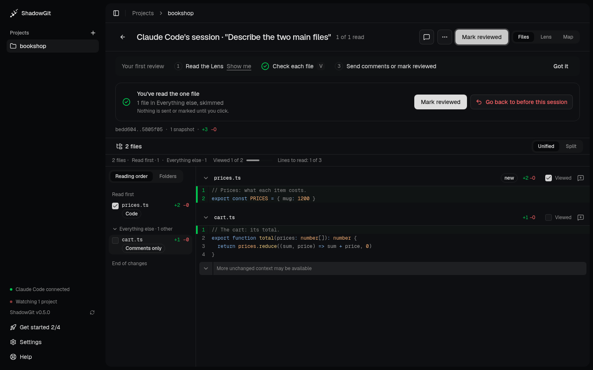
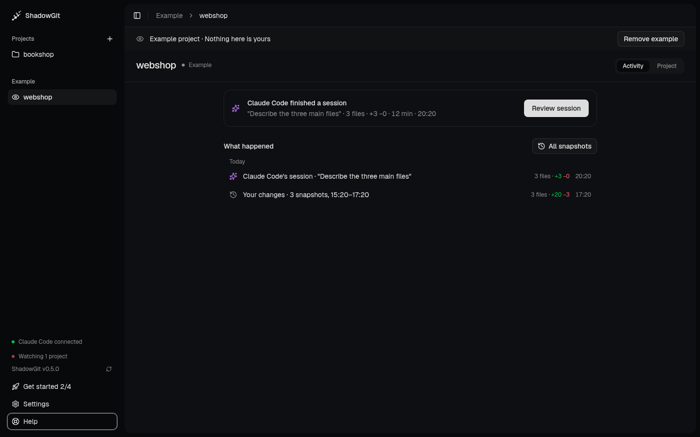

**Get started**, in the app, walks you through four steps, and ticks each one when it really happens. This page shows them in order. You need the ShadowGit app and an AI assistant on your computer (Claude Code, Cursor, VS Code, Codex or Claude Desktop), plus Node.js and Git, which your assistant uses to run ShadowGit's MCP server. [Before you start](/installation#before-you-start) lists the versions.

## 1. Add a project

Click **Add a project** in Get started and pick the project's folder. ShadowGit takes its first snapshot at once, and the step says so: **First snapshot saved**, with the project's name and how many files it holds.

<Frame caption="The first snapshot, saved as the project was added">
  
</Frame>

From then on, ShadowGit saves a snapshot as files change: right away for a large change, within a few minutes for a small one.

## 2. Connect your assistant

Step 2 lists the assistants on your computer, each with **Connect**. Click it. Some assistants want a restart before they see ShadowGit, and the row says so. The other assistants are under **Other assistants**, with what to add to their config by hand. See [Installation](/installation) for every setup.

The step ticks the first time your assistant reaches ShadowGit. Its row then reads **Connected**, with the version of ShadowGit's MCP server it runs.

<Frame caption="Claude Code, connected, with its MCP server's version">
  
</Frame>

If the step says ShadowGit's MCP server is out of date, restart your assistant: it fetches the newest server when it starts.

## 3. Start a session

Step 3 gives a small first task for your project. It asks your assistant to start a ShadowGit session, read the project's map, and add a short comment at the top of the files that matter most. That's a change that is easy to review, and easy to go back on.

**Copy** it and send it to your assistant. With Claude Code on your computer, **Open in Claude Code** opens it in your project with the task typed in, for you to send. Or give your assistant a real task instead: any session in the project shows up the same way.

<Frame caption="Step 3: the first task, written for your project">
  
</Frame>

While your assistant works, the step says so. Turn on **Notify me when it finishes** to be told when the session ends. When it does, your assistant tells you where to review it, and the project's [Activity](/activity) says **Claude Code finished a session**.

<Frame caption="Activity, once the session ends">
  
</Frame>

## 4. Review it

Click **Review session**. The first time, a strip above the files says how to review, in three steps that tick as you do them:

1. **Read the Lens**: what your assistant changed, step by step, in its own words. **Show me** opens it.
2. **Check each file**: press `V` to mark a file read and go to the next.
3. **Send comments or mark reviewed.**

**Got it** puts the strip away. **Help › How to review** brings it back.

Once you've read the files, the end of the review offers what's left: **Send** your comments to your assistant if you wrote any, **Mark reviewed**, or **Go back to before this session**. Going back undoes the session's files only, and first saves a snapshot of the moment before, so you can undo it too.

<Frame caption="The end of the review: mark it reviewed, or go back">
  
</Frame>

See [Review](/review) for every view and key, and [Comments](/comments) for what your assistant does with yours.

## Not ready yet? See an example

**See an example** opens a finished example project. It's a small webshop with a day of snapshots, one Claude Code session with its Lens words, a docs page, two review comments (one answered) and a rule. You'll find it on:

- the welcome's last screen;
- the license page, where it needs no license;
- Get started;
- the empty app;
- **Help**.

The example is read-only: nothing in it is yours, and nothing you do changes it. **Remove example**, on its banner, takes it away.

<Frame caption="The example project, labelled on every screen">
  
</Frame>
