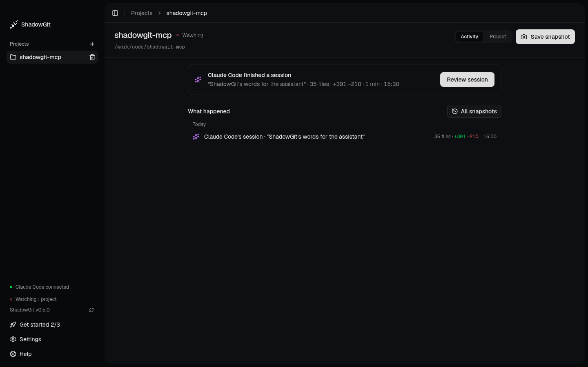

## What is ShadowGit?

ShadowGit is a desktop app that snapshots your projects every few minutes while you work, in a history of its own next to your git. It answers one question about every change, your assistant's or yours: what changed, and is it right? It works in three beats:

1. **ShadowGit records your project.** It saves a snapshot as files change, in a second history beside your own. Your git is never touched.
2. **Your assistant works in sessions.** Connect it once. It tells ShadowGit when it starts and finishes a piece of work.
3. **Review each session, and go back.** Read what changed in your assistant's words, send comments back, or return to any moment.

[Your first session](/first-session) walks through the three, as the app's Get started does. You meet ShadowGit in three places:

- **[Activity](/activity)**, a project's home: what your assistant is doing now, and what happened, newest first. When a session ends, **Review session** is one click away.
- **[Review](/review)** reads one change end to end, with a main button from **Start review** to **Mark reviewed**, in three views: **Files** in reading order, the **[Lens](/lens)**, which tells the change step by step beside a canvas of its code, and the **[Map](/map)**, which shows where it lands in your whole project.
- **Project** draws your whole project on the [Map](/map), with a [docs page](/docs) for each area in your assistant's words.

Around them, [your rules](/your-rules) say what must not depend on what, and ShadowGit checks each snapshot your assistant saves against them. [Restore](/activity#restore-a-snapshot) brings your files back to any snapshot. [Comments](/comments) tell your assistant what you want changed.

Through the ShadowGit MCP server, Claude Code, Cursor and Claude Desktop read that history too: what changed in the last hour, when a file was last touched, what you tried yesterday. Your assistant stops guessing what changed. It looks.

<Frame caption="A project's Activity, after Claude Code's session: one click to review it">
  
</Frame>

<Card
  title="Install in 2 minutes"
  icon="rocket"
  href="/installation"
  horizontal
>
  One command for Claude Code, one config entry for Cursor or Claude Desktop.
</Card>

## How it works

ShadowGit keeps each project's snapshots in a separate git history, `.shadowgit.git`, inside the project. It never touches your own `.git`, and it adds `.shadowgit.git` to your `.gitignore`.

```text
your-project/
├── .git/              # Your own git history, untouched
├── .shadowgit.git/    # ShadowGit's snapshots
├── src/
└── ...
```

- **Snapshots.** ShadowGit takes the first snapshot when you add a project, then a new one every few minutes while files change, sooner after a large change. You can tune the timing in the app's settings.
- **Sessions and saved snapshots.** Before your assistant edits several files, it starts a ShadowGit session, which pauses automatic snapshots so its half-done edits don't spread over many snapshots. It saves its work as snapshots with a name, ends the session, and tells you where to review it. See [Sessions](/installation#sessions).
- **The map, for your assistant.** Before your assistant changes code, it reads ShadowGit's map: which area the code is in and what depends on it. See [Your project's architecture](/installation#architecture).
- **Docs, written as you work.** At the end of a session, your assistant writes the pages of the areas it changed, and ShadowGit counts the changes since. See [Docs](/docs).
- **Restore.** In the app you can bring a project back to any snapshot. Changes not yet in a snapshot are backed up first. See [Activity and snapshots](/activity).

## Why use it

<Columns cols={3}>
  <Card
    title="Answers from history"
    icon="clock"
  >
    Your assistant runs `git log` and `git diff` on the snapshots to see what changed, instead of guessing from today's code.
  </Card>
  <Card
    title="Diffs, not whole files"
    icon="crosshairs"
  >
    It reads only what changed, which keeps its context small.
  </Card>
  <Card
    title="Nothing lost"
    icon="brain"
  >
    Work you never put in your own git is in a snapshot, unless `.shadowgit-ignore` leaves it out, and you can restore any snapshot.
  </Card>
</Columns>

## Get started

<Columns cols={2}>
  <Card
    title="Your first session"
    icon="flag-checkered"
    href="/first-session"
  >
    Add a project, connect your assistant, and review its first session.
  </Card>
  <Card
    title="Installation"
    icon="download"
    href="/installation"
  >
    Requirements, setup and what to ask.
  </Card>
  <Card
    title="Claude Code"
    icon="asterisk"
    href="/ai-tools/claude-code"
  >
    Add ShadowGit to Claude Code with one command.
  </Card>
  <Card
    title="Cursor"
    icon="code-simple"
    href="/ai-tools/cursor"
  >
    Add ShadowGit to Cursor.
  </Card>
  <Card
    title="Review"
    icon="list-check"
    href="/review"
  >
    Read a change end to end, from Start review to Mark reviewed.
  </Card>
  <Card
    title="The Map"
    icon="map"
    href="/map"
  >
    See your whole project, and where a change lands.
  </Card>
  <Card
    title="Download ShadowGit"
    icon="desktop"
    href="https://shadowgit.com"
  >
    Get the desktop app that takes the snapshots.
  </Card>
</Columns>

## Privacy and security

- **Your code stays on your computer.** Snapshots are stored in your project, the Lens and the Map are drawn on your computer, and ShadowGit doesn't upload any of them. It does send usage data and error reports, which you can turn off, plus license checks. See [Privacy](/settings#privacy).
- **The MCP server only talks to the ShadowGit app on your computer.** What your assistant reads through it goes to your AI provider, like any file the assistant opens.
- **Through ShadowGit, your assistant reads, and adds saved snapshots, Lens words, docs pages and replies to your comments, nothing else.** It reads the snapshot history with read-only git commands, and the Map and the Lens. Through ShadowGit it can't change your files, your own git history or existing snapshots.

## Requirements

- The ShadowGit app on macOS 13 or later, Windows 10 or later (64-bit) or Linux (x64 or arm64). Saved snapshots need version 0.3.4 or later, the Lens 0.3.6, the Map 0.3.9, the map for your assistant 0.3.10, the Lens's dependencies and your rules 0.3.11, Docs 0.3.14, and comments for your assistant 0.4.0. Activity, Review, Project and Get started need 0.5.0, and Get started's four steps, the example project and going back to before a session 0.6.0.
- Git
- Node.js 20 or later, which runs the MCP server
- Claude Code, Cursor, Claude Desktop or another MCP client
