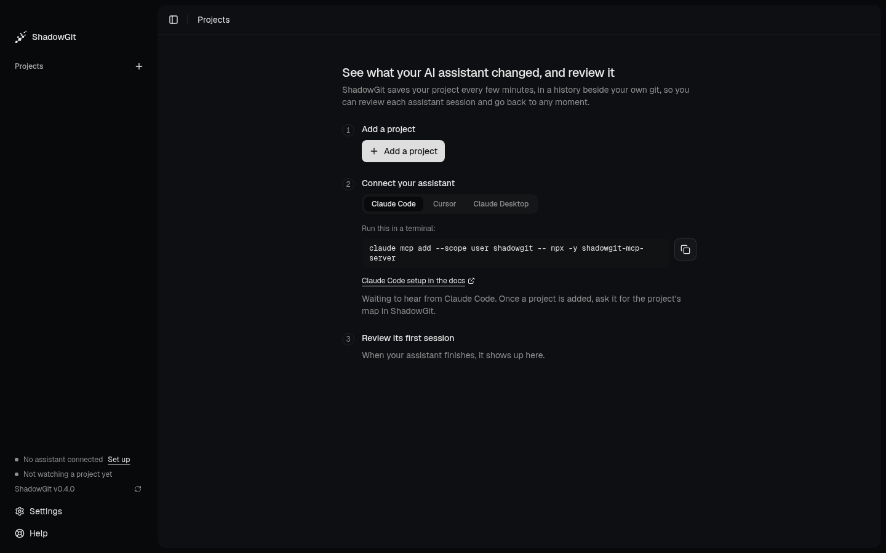

## Before you start

1. **The ShadowGit app**, running and tracking at least one project ([Download ShadowGit](https://shadowgit.com)). Saved snapshots need version 0.3.4 or later, the Lens 0.3.6 or later, the map 0.3.10 or later, docs 0.3.14 or later, review comments 0.4.0 or later, and Activity, Review, Project and Get started after 0.4.0. Versions before 0.3.3 can't update themselves: [download the latest](https://shadowgit.com) once. To track a project, click **Add a project** in the app and pick its folder.
2. **Node.js 20 or later** ([Download Node.js](https://nodejs.org)). Check with `node --version`.
3. **Git** ([Download Git](https://git-scm.com/downloads)). Check with `git --version`.

You don't install the MCP server yourself: your AI tool starts it with `npx`, which downloads it the first time.

## Connect your AI tool

<Columns cols={2}>
  <Card
    title="Claude Code"
    icon="asterisk"
    href="/ai-tools/claude-code"
  >
    One command, every project.
  </Card>
  <Card
    title="Cursor"
    icon="code-simple"
    href="/ai-tools/cursor"
  >
    One entry in `mcp.json`.
  </Card>
</Columns>

### Claude Desktop

1. Open Claude Desktop's **Settings** from the Claude menu (not the settings inside the chat window), go to **Developer** and click **Edit Config**. This opens `claude_desktop_config.json`, creating it if needed:
   - macOS: `~/Library/Application Support/Claude/claude_desktop_config.json`
   - Windows: `%APPDATA%\Claude\claude_desktop_config.json`
2. Add ShadowGit under `mcpServers`:
   ```json
   {
     "mcpServers": {
       "shadowgit": {
         "command": "npx",
         "args": ["-y", "shadowgit-mcp-server"]
       }
     }
   }
   ```
3. Quit Claude Desktop completely and open it again.

### Upgrading from an older setup

Earlier versions of this page installed the server with `npm install -g shadowgit-mcp-server` and started it as `shadowgit-mcp-server`. That copy stays on the old version. Remove it:

```bash
npm uninstall -g shadowgit-mcp-server
```

Then set ShadowGit up again for your tool as described above. In Claude Code, run `claude mcp remove shadowgit` first.

## Get started in the app {#get-started-in-the-app}

<Frame caption="Get started, on an app with no project yet">
  
</Frame>

The app opens on **Get started**, three steps that tick themselves as they happen:

1. **Add a project.** Ticks once ShadowGit has taken the project's first snapshot.
2. **Connect your assistant.** A tab for each of Claude Code, Cursor and Claude Desktop holds its setup command, with a button to copy it. A line says ShadowGit is waiting to hear from your assistant. The step ticks the first time your assistant asks ShadowGit about a project it watches, naming it: ask it, for example, `How is this project organised?`. Listing your projects doesn't tick it, because that names none. Then the sidebar says, for example, "Claude Code connected".
3. **Review its first session.** Ticks when you mark a session reviewed in [Review](/review).

Once you've added a project, Get started shrinks to **Get started 1/3** in the sidebar until the three are done. Click it, or **Help**, to open it again, with links to these docs. **Hide** puts it away.

## Check that it works

Ask your assistant:

```text
Show me my ShadowGit projects
```

It lists the projects ShadowGit tracks, with their last snapshot and any active session.

## What to ask

Ask in your own words. These are examples.

### Your history

```text
What changed in the last hour?
```

```text
Show me the history of Header.tsx
```

Your assistant answers with read-only git commands (`log`, `diff`, `show`, `blame`) on the snapshots.

When you start Claude Code inside a tracked project, you don't need to name the project. Otherwise, and always in Cursor and Claude Desktop, name it when ShadowGit tracks more than one:

```text
What changed in webshop in the last hour?
```

```text
Show me the last 10 snapshots in webshop
```

### Your project's architecture {#architecture}

```text
How is this project organised?
```

```text
What depends on chargeCard?
```

Your assistant reads ShadowGit's [Map](/map) of the project: its areas and layers, and the calls and imports between them. For a file or a function, it learns which area it's in, what it uses and what depends on it, area by area. Before it changes code, it looks that code up on its own.

The map counts the calls and imports it can follow in the code. It leaves out test files, and code put together while the program runs, such as an import whose path is built from strings. A call to a method isn't always traced to its class, so a method may have more callers than the map lists. When the map is a few snapshots behind the newest, your assistant is told which files changed since.

If your project has [rules](/your-rules), such as "src/jobs never depends on src/api", your assistant reads the ones that hold for the code it's about to change, and keeps to them. Each snapshot it saves is checked against them, and it tells you why when a change needs a link a rule names. This needs ShadowGit 0.3.11 or later and version 2.5.0 or later of the MCP server.

This needs the ShadowGit app running, in version 0.3.10 or later.

### Sessions {#sessions}

A session keeps an assistant's edits together. Before a change that touches several files:

<Steps>
  <Step title="Start a session">
    ```text
    Start a ShadowGit session for debugging
    ```
    Automatic snapshots pause for that project.
  </Step>
  <Step title="Let your assistant make its changes">
    Automatic snapshots stay paused while it works.
  </Step>
  <Step title="Save a snapshot">
    ```text
    Save a snapshot in ShadowGit named 'Fixed auth bug'
    ```
    ShadowGit saves the changes as one snapshot with that name, leaving out the files listed in `.shadowgit-ignore`.
  </Step>
  <Step title="End the session">
    ```text
    End the current ShadowGit session
    ```
    Automatic snapshots resume, and your assistant tells you where to review the session: open the project in ShadowGit, then **Review session**.
  </Step>
</Steps>

Your assistant does this by itself when it's about to edit several files, and in a project with [rules](/your-rules) before any edit, so each snapshot it saves is checked against them. While a session runs, [Activity](/activity)'s card says your assistant is working. A session ends when your assistant ends it, after 30 minutes with no change in the project, or 2 hours after your assistant last reached ShadowGit, so a session left behind never holds snapshots back for long. Being told where to review needs ShadowGit after 0.4.0 and version 2.9.0 or later of the MCP server.

Sessions and saved snapshots need the ShadowGit app running. Reading history works while it's closed.

### The Lens in your assistant's words {#lens-words}

ShadowGit's [Lens](/lens) shows a change as numbered steps beside a canvas of the code it touches. On its own, ShadowGit writes the Lens's text from the code. Your assistant, which made the change, writes it instead at the end of a session. To ask anyway:

```text
Write the Lens words for this session
```

Your assistant reads the session's Lens, then writes a summary, a title and a sentence or two for each step, and the role each component plays. Open the session in [Review](/review) and click **Lens** to read them. ShadowGit keeps the words in its history: a component's role still shows in later changes while its code is unchanged.

Your assistant also reads the session's [dependencies](/lens#dependencies), such as "jobs depends on api for the first time", so its words can say why one appeared. This needs ShadowGit 0.3.11 or later and version 2.4.0 or later of the MCP server.

This needs the ShadowGit app running, in version 0.3.6 or later.

### Your project's docs {#docs}

ShadowGit's [Docs](/docs) keeps a page for each area of your project. At the end of a session, after the Lens words, your assistant writes the pages of the areas it changed, when they have no words or are behind. You can ask too:

```text
What does the billing area do?
```

Your assistant reads the area's page: its words, the facts ShadowGit draws from the map, and what changed since the words.

```text
Document this project in ShadowGit
```

Your assistant writes every page that has no words yet, five at a time, from the code it reads.

This needs the ShadowGit app running, in version 0.3.14 or later, and version 2.6.0 or later of the MCP server.

### Your review comments {#comments}

When you've sent [comments](/comments) from ShadowGit's Review, ask:

```text
Address my ShadowGit review comments
```

Your assistant reads the comments you sent and haven't closed, changes only what each one asks, and replies to each. For anything else, it asks you first. Only you close a comment, in ShadowGit.

This needs the ShadowGit app running, in version 0.4.0 or later, and version 2.7.0 or later of the MCP server.

## Troubleshooting

### "ShadowGit isn't running"

Your assistant tried to start a session or save a snapshot while the app was closed. Open ShadowGit and ask again.

### "ShadowGit is not tracking any project yet"

Click **Add a project** in the app and pick your project's folder. ShadowGit takes the first snapshot right away.

### "No ShadowGit project contains …"

Your assistant was started in a folder ShadowGit doesn't track, and ShadowGit tracks more than one project, so it can't pick one. Add that folder in the app, or name one of your tracked projects in your question.

### "This version of ShadowGit can't save snapshots for AI assistants"

Update the ShadowGit app to 0.3.4 or later from [shadowgit.com](https://shadowgit.com).

### "This version of ShadowGit has no Lens for AI assistants"

Update the ShadowGit app from [shadowgit.com](https://shadowgit.com).

### "This version of ShadowGit has no map for AI assistants"

Update the ShadowGit app to 0.3.10 or later from [shadowgit.com](https://shadowgit.com).

### "This version of ShadowGit has no docs pages for AI assistants"

Update the ShadowGit app to 0.3.14 or later from [shadowgit.com](https://shadowgit.com).

### "This version of ShadowGit has no review comments for AI assistants"

Update the ShadowGit app to 0.4.0 or later from [shadowgit.com](https://shadowgit.com).

### "ShadowGit answered with a … this version of shadowgit-mcp-server does not read"

The ShadowGit app is newer than the MCP server your assistant runs. Quit your AI tool and open it again, so it starts the newest server. If the message comes back, your tool runs an older copy. If you installed the server with `npm install -g`, follow [Upgrading from an older setup](#upgrading-from-an-older-setup). Otherwise, set ShadowGit up again for your tool, writing `npx -y shadowgit-mcp-server@latest` where the setup says `npx -y shadowgit-mcp-server`.

### Your assistant doesn't see ShadowGit

1. Check `node --version`: the MCP server needs Node.js 20 or later.
2. Run the server in a terminal:
   ```bash
   npx -y shadowgit-mcp-server
   ```
   It starts and waits without printing anything. Stop it with `Ctrl+C`. If it prints an error instead, that error is the problem.
3. Then follow the checks for your tool: [Claude Code](/ai-tools/claude-code#troubleshooting) or [Cursor](/ai-tools/cursor#troubleshooting). In Claude Desktop, quit the app completely and open it again; **Settings → Developer** shows whether ShadowGit connected, and the server's errors are in `mcp-server-shadowgit.log`:
   - macOS: `~/Library/Logs/Claude`
   - Windows: `%APPDATA%\Claude\logs`

## Installing on Linux

ShadowGit comes as a `.deb`, an `.rpm` and an AppImage, for x64 and arm64. Download yours from [shadowgit.com](https://shadowgit.com).

<Tabs>
  <Tab title="Debian and Ubuntu">
    ```bash
    sudo apt install ./ShadowGit-linux-*.deb
    ```
  </Tab>
  <Tab title="Fedora">
    ```bash
    sudo dnf install ./ShadowGit-linux-*.rpm
    ```
  </Tab>
  <Tab title="AppImage">
    The AppImage runs on any distribution but needs FUSE 2:

    ```bash
    # Ubuntu 24.04 and later
    sudo apt install libfuse2t64

    # Ubuntu 22.04 and Debian
    sudo apt install libfuse2

    # Fedora
    sudo dnf install fuse-libs

    # Arch
    sudo pacman -S fuse2
    ```

    Then make it executable and run it:

    ```bash
    chmod +x ShadowGit-linux-*.AppImage
    ./ShadowGit-linux-*.AppImage
    ```

    Without FUSE, extract it and run it from the extracted folder:

    ```bash
    ./ShadowGit-linux-*.AppImage --appimage-extract
    ./squashfs-root/AppRun
    ```
  </Tab>
</Tabs>

## Where ShadowGit keeps its data

| What | Where |
|---|---|
| Snapshots | `.shadowgit.git` inside each project |
| Files left out of snapshots | `.shadowgit-ignore` inside each project |
| Project list, settings and maps | macOS: `~/.shadowgit`<br />Windows: `%LOCALAPPDATA%\shadowgit`<br />Linux: `~/.local/share/shadowgit` |

ShadowGit creates `.shadowgit-ignore` with common dependency and build folders when you add a project. To leave out more, see [Leave files out](/activity#leave-files-out).

For the MCP server's own settings, see its [README on GitHub](https://github.com/alessandro-afloarei/shadowgit-mcp#configuration).
