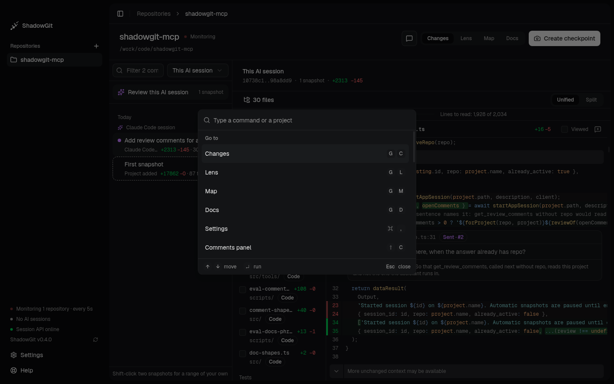
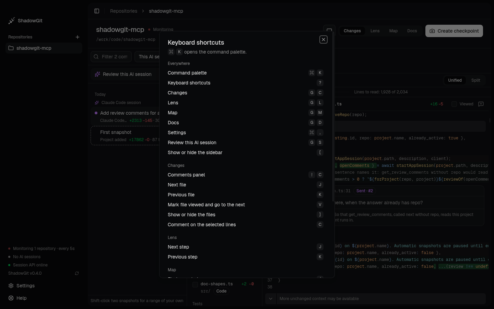

You can review a change without the mouse. `⌘K` opens the command palette, and `?` lists every key.

On Windows and Linux, `⌘` is `Ctrl` and `⇧` is `Shift`, and ShadowGit shows them that way. `G` then `C` means two keys, one after the other.

## The command palette

<Frame caption="The command palette, opened over Changes">
  
</Frame>

`⌘K` opens it from anywhere, from a text field too. It lists what you can do on the screen you're on, grouped as **Go to**, **Review**, **Snapshots** and **App**, each with its keys, then your projects. Type to filter, and press `↵` to run a command.

These commands have no key. Run them from the palette, or from their buttons:

- **Show the changes since the last checkpoint** and **Show today's changes**
- **Send comments to agent…**
- **List files in reading order** and **List files by folder**
- **Show the diff unified** and **Show the diff split**
- **Create checkpoint**, **Restore this snapshot…** and **Tag this snapshot…**
- **Add project…**, and the themes: **Theme: light**, **Theme: dark** and **Theme: as the system**

## The shortcut sheet

<Frame caption="The shortcut sheet: every key, by where it works">
  
</Frame>

`?` opens it. It lists the keys below by where they work. Single keys do nothing while you type in a field or while a dialog is open. `⌘` keys also work from a field.

## Everywhere

| Key | Does |
|---|---|
| `⌘K` | Command palette |
| `?` | Keyboard shortcuts |
| `G` then `C` | [Changes](/snapshots) |
| `G` then `L` | [Lens](/lens) |
| `G` then `M` | [Map](/map) |
| `G` then `D` | [Docs](/docs) |
| `G` then `S` | Review this AI session |
| `⌘,` | Settings |
| `[` | Show or hide the sidebar |

## Changes

| Key | Does |
|---|---|
| `J` / `K` | Next file / previous file |
| `V` | Mark the file viewed and go to the next |
| `]` | Show or hide the files |
| `C` | Comment on the selected lines |
| `⇧C` | [Comments](/comments) panel |

## Lens

| Key | Does |
|---|---|
| `J` / `K` | Next step / previous step |

## Map

| Key | Does |
|---|---|
| `/` | Find a symbol or area |
| `Esc` | Back from a selection |

## Lists

In the snapshot list and the Docs list:

| Key | Does |
|---|---|
| `↑` / `↓` | Previous / next |
| `Home` / `End` | First / last |
| `↵` | Open |
| `⇧↵` | Mark one end of a range |
| `Esc` | Let go of a marked end |

In Changes, `↑` and `↓` open each snapshot as you move. In the Lens and the Map they only move, and `↵` opens the snapshot in Changes.

## Writing

| Key | Does |
|---|---|
| `⌘↵` | Save a comment, or send your comments |
| `Esc` | Close without saving |
