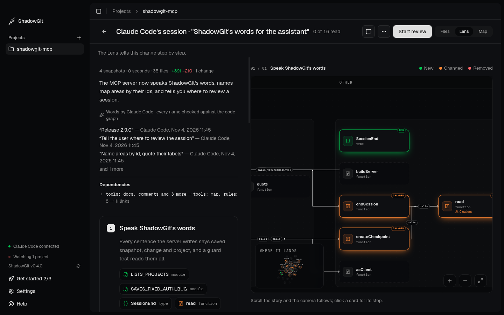
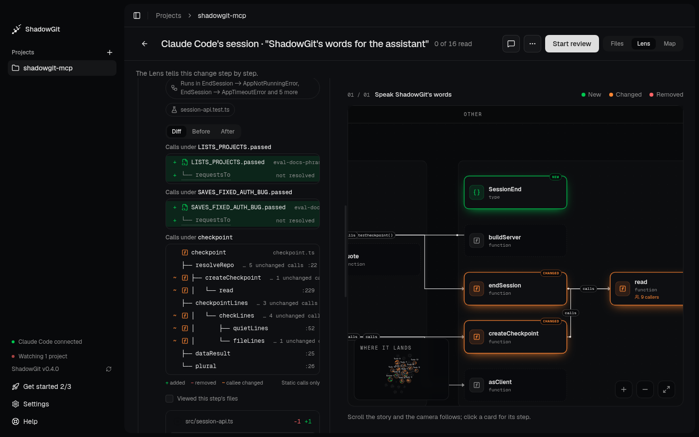

The Lens shows what a change does to your code before you read the diff. Each numbered step names the functions, classes and types it adds, changes or removes, and a canvas beside the steps draws those pieces and how they call each other.

<Frame caption="The Lens of Claude Code's session, in the words of the assistant that made the change">
  
</Frame>

## Open the Lens

The Lens is one of [Review](/review)'s three views: open a change, then click **Lens** at the top right, or press `G` then `L`. It reads the change Review has open, a session, your own changes or two snapshots you compare.

The Lens needs ShadowGit 0.3.6 or later, and is a view in Review after 0.4.0.

New snapshots don't redraw what you're reading. When they arrive, **Newer snapshots: update** appears at the top. Click it to read the change up to the newest snapshot.

## Read it

- **The top** counts the change's snapshots, files, added and removed lines and changes. Below the counts are a summary, the names of the snapshots saved in the change, the links the change adds that [your rules](/your-rules) name, and the change's [dependencies](#dependencies).
- **Each step** says what it adds, changes or removes, in order. Its names link to their cards on the canvas. **Also in this step** lists the other pieces it touches, and a line like "Reaches 14 symbols in 5 files" says how much code depends on it. **Show code** opens the step's code.
- **The canvas** draws a card for each function, class or type, marked **New**, **Changed** or **Removed**, with arrows for the calls between them. Layers run as captions across the top.

Scroll the steps and the canvas follows. Click a card to open its step, or press `J` and `K` to move to the next and previous step. **Where it lands**, in the canvas's corner, opens the change on the [Map](/map#where-a-change-lands).

Under each step, **Viewed this step's files** marks its files viewed, as in [Files](/review#files). To comment on a step's code, point at a line and click the **+** beside its number, or drag across lines. The button that sends your comments is at the top here too, as in [Comments](/comments).

## Calls

<Frame caption="A step's calls: new calls marked with +, and calls to functions the change altered marked with ~">
  
</Frame>

A step that changes what its functions call shows the calls as trees, each headed like **Calls under getDocs**:

| Mark | Means |
|---|---|
| `+` | A call the change adds |
| `−` | A call the change removes, struck through, at the line it was on |
| `~` | A call that stays, to a function the change altered |

**Diff** shows both sides. **Before** and **After** show the calls as they were and as they are. A row linked to a card on the canvas opens it. The trees hold the calls ShadowGit reads in the code itself (**Static calls only**), so a call made through a variable, such as a callback, may be missing. A long tree ends with how many more calls it holds. Calls need ShadowGit 0.4.0 or later.

## Dependencies

Under the summary, **Dependencies** says what the change makes depend on what, between your project's areas (the parts the [Map](/map) draws) and its layers:

| Line | Means |
|---|---|
| jobs depends on api for the first time | Code in jobs imports code in api, and none did before. |
| billing no longer depends on jobs | The last import from billing into jobs is gone. |
| api and billing now depend on each other | Each imports the other, and they didn't both before. |
| api → billing: 3 → 5 links | A dependency that was already there grew or shrank. |

Click a line for the links behind it, such as "retryFailedCharges (src/jobs/retry.ts:5) calls route (src/api/router.ts:4)". **step 2** beside it opens the step that holds it, and that step names the dependency too.

An import makes a dependency, followed through files that only pass names on. Imports of types count, as "imports types from". Calls, `extends` and `implements` between the two areas count with it, but a call alone, with no import behind it, never makes a line. Test files aren't counted. Layers count when they're where your code runs, such as main and renderer, or packages. The lines say what changed. Whether a dependency belongs there is yours to judge.

The Lens lists up to 12 lines, and says how many more there are. Dependencies need ShadowGit 0.3.11 or later.

## Words from your assistant

ShadowGit writes the steps from the code on its own. The assistant that made the change can write them instead: a summary, a title and a sentence or two for each step, and the role each piece plays. Your assistant does it at the end of a session without being asked. To ask anyway:

```text
Write the Lens words for this session
```

The Lens then shows "Words by Claude Code · every name checked against the code graph" (or your assistant's name), and picks up the words within a few seconds, without a reload. Under **The author says**, a step can quote the name of a snapshot your assistant saved. A step your assistant didn't word says "From the code alone". This needs the [ShadowGit MCP server](/installation) set up in your assistant.

The words belong to that change. A piece's role also shows in later changes while its code is unchanged. ShadowGit keeps the words in the project's `.shadowgit.git`, on your computer.

## What the Lens reads

The Lens reads code in TypeScript, JavaScript, Python, Java, C, C++, C#, Go, Rust, Kotlin, PHP, Ruby and Swift. Other files, such as docs, config and images, show in [Files](/review#files) but not in the Lens. A change that touches only those says "Nothing here changes code", with **Show the files** to open them.

Limits:

- A snapshot of more than 20,000 files or 64 MB of source code is too large to draw, and so is a change whose two ends together pass that.
- Source files over 512,000 characters are skipped.
- A step shows the code of up to 12 files. Read the rest in Files.

## Troubleshooting

When the Lens can't draw a change, it says "Couldn't draw the Lens" and why.

### "This snapshot has too many files for the code graph" or "This snapshot is too large for the code graph"

The project's snapshots hold more than 20,000 files or 64 MB of source. Generated code and copied-in dependencies are the usual cause. Add their folders to `.shadowgit-ignore` (see [Leave files out](/activity#leave-files-out)), and the next snapshots leave them out.

### "Drawing the Lens took longer than 120 s"

Read a smaller change: **Compare two snapshots…** closer together, with fewer changed files between them.
