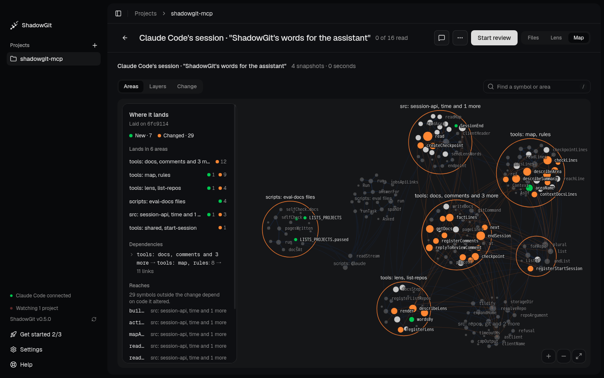
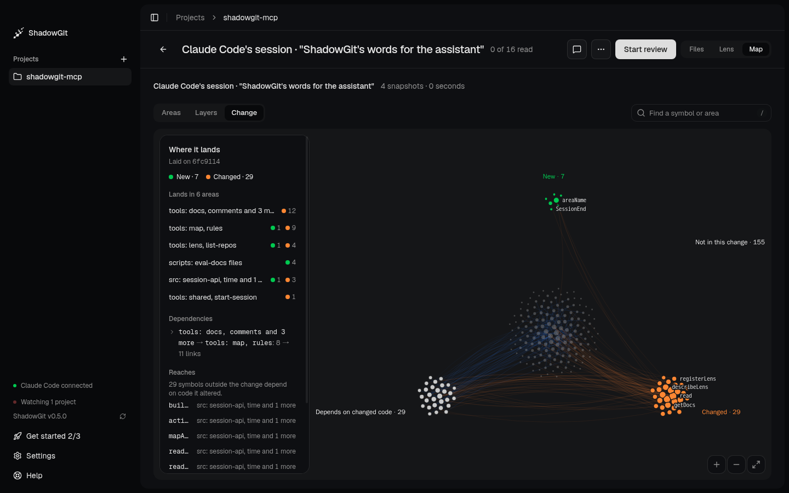

The Map draws your whole project from its newest snapshot. Each area is a folder, or a slice of a big folder named by what it holds, such as "tools: map, rules". Each function, class and type is a dot, and lines show the calls and imports between them. It keeps up with your snapshots, and it shows where a change lands in the rest of your code.

<Frame caption="Where Claude Code's session lands in the ShadowGit MCP server: new code in green, changed code in orange">
  
</Frame>

You meet the Map in two places: **Project** draws the whole project, and the **Map** view in [Review](/review) shows where the change you're reading lands. The Map needs ShadowGit 0.3.9 or later. Project and the Map view in Review need ShadowGit 0.5.0 or later.

## The whole project

Select a project and click **Project** at the top right, or press `G` then `P`. The first time, ShadowGit draws the map of the newest snapshot ("Drawing the map…"). After that, the Map opens straight away on the map ShadowGit kept, and catches up from there.

- **Areas**, the default, groups the code by area.
- **Layers** groups it by where the code runs, or else by package or folder.

The card at the left names the project and the snapshot the map is drawn from, counts its symbols, areas, calls and processes, and lists its largest areas. Type in **Find a symbol or area** to find one on the map, or press `/`. Test files, and folders such as `fixtures` and `e2e`, stay off the map. **Rules**, there once the project has a `.shadowgit-rules`, opens [your rules](/your-rules) as ShadowGit reads them. Click an area, and its card shows the summary of its [docs page](/docs), with **Read its page**. **Docs**, at the top, opens every page beside the map.

## Where a change lands

In Review, click **Map**, or press `G` then `M`, and the map lights the change you're reading. From the [Lens](/lens), **Where it lands** opens it too.

The card's title becomes **Where it lands**. It counts the new and changed pieces and lists the areas the change lands in. Under **Your rules**, it lists the links the change adds that one of [your rules](/your-rules) names. Under **Dependencies**, it lists what the change makes depend on what, the same lines as the [Lens](/lens#dependencies). Under **Reaches**, it names the code outside the change that depends on code it altered.

The map draws each dependency between its two areas: a new one in green, a gone one dashed, and two areas that now depend on each other with a line each way. On a map drawn after the change that split or renamed one of the two areas, the line is listed on the card but not drawn. Dependencies need ShadowGit 0.3.11 or later.

| Dot | Means |
|---|---|
| Green | **New** |
| Orange | **Changed** |
| Orange ring | **Same code, runs elsewhere** or **Same code, exported differently** |
| Grey ring | **Comments only** or **Spacing only** |
| Red ring | **Removed** |

An area with a code change is outlined in orange, and one whose changes are only comments or spacing in grey. So a change that only rewords comments looks different at a glance from one that changes what the code does.

**Change**, the third button beside Areas and Layers here, sets the changed code apart from the code that depends on it and from the rest of the project.

<Frame caption="Change sets the new and changed code apart from what depends on it">
  
</Frame>

A change that touches no code says "Nothing here changes code: the map shows the whole project."

## Keeping up with your snapshots

When new snapshots land, **Newer snapshots: update** appears at the top. Clicking it draws the newest snapshot, and in Review moves the change up to it.

In a small project, where drawing the map takes under 3 seconds, the map redraws itself after each new snapshot while ShadowGit's window is open. Only the change you're reading waits for the click.

A map kept from before an update names the slices of big folders the way the older version did until the next snapshot is drawn. Docs pages stay with their areas either way.

## Your assistant reads it too

Through the [ShadowGit MCP server](/installation), your AI assistant reads the same map: how the project is organised, and what depends on the code it's about to change. It looks before it edits, on its own, and you can ask it too (see [Your project's architecture](/installation#architecture)). Its answers come from the map you see here, name each area as you see it and by an id that stays while the name follows what it holds, and say how many snapshots behind the newest the map is.

This needs ShadowGit 0.3.10 or later. Area ids need ShadowGit 0.5.0 or later and version 2.9.0 or later of the MCP server.

## Where the map is kept

ShadowGit draws the map on your computer and keeps it in its data folder (see [Where ShadowGit keeps its data](/installation#where-shadowgit-keeps-its-data)), under `maps`. It holds the names of your functions, classes and types and the paths of their files, and ShadowGit uploads none of it. What your assistant reads from it goes to your AI provider, like any file the assistant opens. Removing a project deletes its map.

## Troubleshooting

When the Map can't draw, it says "Couldn't draw the map" and why. It has the Lens's limits. A snapshot of more than 20,000 files or 64 MB of source code is too large, and drawing stops after 120 seconds. Leaving generated code and copied-in dependencies out with `.shadowgit-ignore` usually brings a project under them (see [Leave files out](/activity#leave-files-out)).

If showing where a change lands fails, the Map says "Couldn't light these snapshots" and why.
