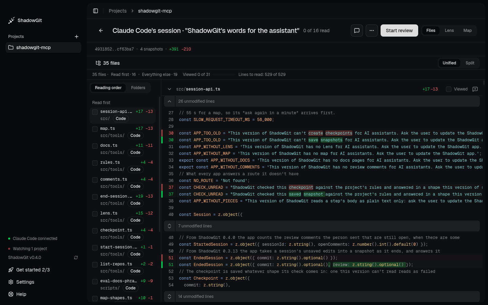

<Frame caption="Claude Code's session in Review: its files in reading order, and the diff">
  
</Frame>

**Review** reads one change, from its first snapshot to its last: an assistant's session, your own changes, or two snapshots you compare. It has three views of the same change, **Files**, **Lens** and **Map**, and one main button that always says what to do next. This page describes ShadowGit 0.5.0 and later.

## Open a change

- **Review session**, on [Activity](/activity)'s card, opens the session that waits for you.
- Click any row of Activity's **What happened**: a session, a run of your changes, a saved snapshot.
- In the command palette (`⌘K`): **Review the latest session** (`G` then `S`), **Review since you last saved**, **Review today**, or **Compare two snapshots…**, which lets you pick the two ends from your snapshots.

The top of Review names the change, says how many of its files you've read, and holds the main button and the three views. The arrow on the left goes back to Activity.

## The main button

The button at the top right changes as you read:

| It says | When | It does |
|---|---|---|
| **Start review** | You haven't started | Opens Files on the first file to read |
| **Next file** `V` | Files under Read first are still unread | Marks the file viewed and moves to the next |
| **Send 2 comments to Claude Code** | Read first is read and comments wait | Opens the [Send](/comments#send-them-to-your-assistant) |
| **Mark reviewed** | A session's Read first is read and nothing waits | Marks the session reviewed and goes back to Activity |
| **Done** | Read first is read and the change is already reviewed, or isn't a session | Goes back to Activity |
| **Claude Code is still working** | The session is running | Nothing yet |
| **Newer snapshots: update** | The change moved on since you opened it | Reads the newest version |

Once Read first is read, a card says so: how many files you read, the comments still for your assistant, and the files in Everything else you skimmed. Nothing is sent or marked until you click. A session's review is finished when you mark it reviewed, when you send its comments once it has ended, or when you go back to before it. That's kept per project, across restarts.

## Your first review

The first time you review a session, a strip under the header, **Your first review**, says how in three steps that tick as you do them: read the Lens, with **Show me**; check each file, with `V`; then send your comments or mark the session reviewed. **Got it** puts it away. **How to review**, in the Help menu, or **Show the review guide**, in the command palette, brings it back. This needs ShadowGit 0.6.0 or later.

## Files

Files lists the change's files on the left and shows their diff on the right.

- **Reading order**, the default, lists code under **Read first**, the files more code depends on first. **Everything else** holds the rest, each tagged: tests, next to the file they test; config, docs, styles and other files; changes to comments or spacing only. Lockfiles, generated and minified files, binaries and diffs of more than 2,000 lines are folded behind one line, such as "2 lockfiles, 1 generated file folded · 4,210 lines", that opens them. **Folders** lists the same files by folder, and ShadowGit remembers your choice for each project.
- ShadowGit works out the order a moment after you open the change. Once you scroll, click or press a key, the order holds still, and a better one waits for **Apply**.
- Tick **Viewed** on a file, or press `V`, to mark it viewed and move to the next. ShadowGit remembers what you viewed for each version of a file, so the same version reads as viewed in any change. A file that changed again reads "Changed since you viewed it". What you viewed stays on your computer, never in your project.
- **Unified** and **Split** switch how the diff is drawn. `]` shows or hides the list, and `J` and `K` move between files.
- Select lines and press `C`, or click **+** beside a line number, to comment. See [Comments for your assistant](/comments).

## The Lens and the Map

The same change, two other ways:

- **Lens** tells the change step by step, with a canvas of the code it touches. See [The Lens](/lens).
- **Map** shows where the change lands in your whole project. See [The Map](/map#where-a-change-lands).

`G` then `F`, `L` or `M` switches between the three views from anywhere.

## The "…" menu

The "…" at the top holds what you need less often: **Save snapshot**, **Save snapshot with a name…**, **Compare two snapshots…** and **All snapshots**. When Review reads one snapshot, it also holds **Restore this snapshot…** and **Tag this snapshot…**, which adds tags and a note so you can find the snapshot again. Each is in the command palette too.

## Go back to before a session

At the end of a session's review, once the session has ended, **Go back to before this session** undoes what it changed. Its confirmation lists the session's files by what happens to each: **Goes back**, **Comes back** or **Goes away**. Files you changed after the session are listed apart, because your later edits to them go back too.

- Only the session's files change. Every other file stays as it is.
- ShadowGit first saves a snapshot of the project as it is, named "Before going back to before" and the session's title, so you can return to that moment. Then it saves a snapshot of the result.
- It refuses while your assistant is working in the project, and when a file or folder of yours stands where going back would put one of the session's files. A session that started with ShadowGit's first snapshot of the project doesn't offer it, since going back would delete every file.
- If going back stops partway, ShadowGit says so and names the snapshot of the moment before.

Going back needs ShadowGit 0.6.0 or later.

## Reviewed sessions

A session you marked reviewed no longer waits on Activity's card. Its row stays in What happened, and you can open and read it again any time. Sessions that ended before you updated to this version count as reviewed, so Activity never opens on one from weeks ago.
