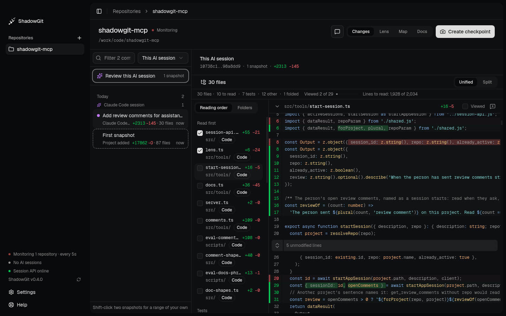

## Add a project

Click **+** next to **Repositories** in the sidebar, or **Add a repository** when you have none yet, and pick the project's folder. ShadowGit then:

- creates `.shadowgit.git` in the folder, which holds the snapshots, and adds it to the project's `.gitignore`;
- creates `.shadowgit-ignore`, listing what to leave out (see [Leave files out](#leave-files-out));
- takes the first snapshot, listed as **First snapshot**.

Your own `.git` stays as it is.

## When ShadowGit takes a snapshot

Every 5 seconds ShadowGit looks for changed files. A change of 25 lines or more is saved at the next look. Smaller changes wait until at least 3 minutes have passed since the last snapshot, so a run of small edits lands in one snapshot. You can change these numbers in **Settings**, under **Monitoring** and **Commits**.

To save a snapshot right away, click **Create checkpoint** at the top right. While an assistant's [session](/installation#sessions-and-checkpoints) is running, automatic snapshots pause for that project, and the assistant saves its work as one checkpoint at the end.

## Read a snapshot

<Frame caption="Changes reviewing an AI session: its snapshots on the left, its files in reading order, and the diff">
  
</Frame>

Select a project: **Changes** lists its snapshots, newest first, under a heading for each day. Each row says:

- who saved the snapshot and why (see the table below);
- what it changed, like `+132 −106 · 7 files`;
- when: `now`, `4m` or `2h` today, a time like `18:40` before. Point at a row for its full date and hash.

A purple dot marks a snapshot an AI tool made. An AI session's snapshots sit under that session's heading, like **Claude Code session**.

| Row | Under it | Saved by |
|---|---|---|
| **First snapshot** | Project added | ShadowGit, when you add the project |
| **Automatic snapshot** | | ShadowGit, as you work (see above) |
| **Automatic snapshot** | In an AI session | ShadowGit, while an AI tool edits the project |
| **Checkpoint** | You | You, with **Create checkpoint** |
| Your assistant's message, like "Fixed auth bug" | Claude Code checkpoint, or your assistant's name | Your assistant, at the end of a session |
| **Before restoring 4f2a91c**, **Restored 4f2a91c** | Restore | A restore (see below) |

Click a snapshot, or move with `↑` and `↓`, to see what it changed since the one before.

## Review a range

To read several snapshots as one change, pick a range:

- **Review this AI session**, pinned above the list, or `G` then `S`, reads your assistant's latest session, from where it started to its last snapshot.
- The **Range** menu offers **Since last checkpoint**, **This AI session** and **Today**.
- Click a session's heading in the list to review that session.
- For a range of your own, shift-click two snapshots, or press `⇧↵` on each. `Esc` lets go of the first.

The top names the range, with its first and last snapshot, how many snapshots it holds and the lines added and removed. In the list, the range's snapshots are lit and the snapshot it starts from is outlined. New snapshots don't change what you're reading. When they move a range like **This AI session**, **Newer snapshots: update** appears, to read the range up to the newest.

## Read in reading order

ShadowGit lists the files in the order to read them:

| Group | Holds |
|---|---|
| **Read first** | Code, the files more code depends on first |
| **Tests** | Test files, each next to the file it tests |
| **Other changes** | Config, docs, styles, SQL and other files |
| **Quiet** | Changes to comments or spacing only, and renames with no other change |
| **Folded** | Lockfiles, generated and minified files, test snapshot files, binaries, changes to a file's mode, and diffs of more than 2,000 lines |

Folded files start closed. The line under them, such as "2 lockfiles, 1 generated file folded · 4,210 lines", opens them. **Folders** lists the files by folder instead, and ShadowGit remembers your choice for each project.

The bar above the files counts each group. Click a count to show only that group. It also says how many files you've viewed and how many lines are left to read. ShadowGit works out the order from the code a moment after you open the range. Once you scroll, click or press a key, the order holds still, and a better one waits for **Apply**.

To mark a file viewed, tick **Viewed** in its header or in the list, or press `V`, which also goes to the next file. ShadowGit remembers what you viewed for each version of a file, so the same version reads as viewed in any range. When the file changes again, it shows "Changed since you viewed it". What you viewed stays on your computer, in ShadowGit's own storage, never in your project.

- **Unified** and **Split** switch between one column and two.
- The file count above the diff, like **30 files**, shows the file tree. So does `]`.
- `J` and `K` move to the next and previous file, and `[` folds the sidebar.
- **Tags** adds tags and a note to a snapshot, so you can find it again.

To say what you want changed, write a [comment](/comments) on the lines. Every key is on the [Keyboard](/keyboard) page.

## Restore a snapshot

Select the snapshot, click **Restore**, then **Restore commit**. ShadowGit:

1. saves changes not yet in a snapshot, leaving out the files in `.shadowgit-ignore`, listed as **Before restoring** and the snapshot's hash;
2. writes your files back as they were in that snapshot;
3. records the result, listed as **Restored** and the snapshot's hash.

Restore writes back the files the snapshot holds. Files you created after it stay in your folder, so delete them yourself if you want them gone. To undo a restore, restore the **Before restoring** snapshot.

Restore changes the files in your folder, never your own git history.

## Leave files out

`.shadowgit-ignore`, in the project's folder, lists what ShadowGit leaves out of its snapshots: dependency folders like `node_modules`, build output, logs, lockfiles, editor and system files. Edit it to leave out more, one pattern per line:

```text
# a folder and everything in it
coverage/**
# every file with this extension
*.sqlite
```

`*` matches within one folder, `**` across folders and `?` one character. New snapshots follow the file. The ones already taken keep what they hold.

## Remove a project

Point at the project in the sidebar, click the trash icon, then **Remove repository**. ShadowGit stops watching it and deletes:

- the `.shadowgit.git` folder, with every snapshot;
- the `.shadowgit-ignore` file;
- the `.shadowgit.git` line in `.gitignore`;
- the project's [map](/map).

Your files and your own git history stay as they are.
