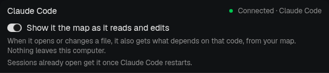

Your assistant reads ShadowGit's [map](/map) through the [MCP server](/installation). With ShadowGit 0.7.0 or later and version 2.11.0 or later of the MCP server, it gets the map's facts at three moments, without asking:

1. **As a session starts**: the outline of your whole project.
2. **After it reads a file**: where the file sits, and what other areas use from it.
3. **After it edits a file**: what changed, and the code that depends on it.

The first needs nothing from you. The other two come through hooks in your assistant's settings, which you turn on in ShadowGit. Everything is drawn on your computer from the map you see in ShadowGit, and is said once: when there is nothing to say, your assistant gets nothing extra.

## As a session starts

The outline is in the MCP server's instructions. Claude Code reads them as a session starts, before your first question; Codex gives them to its model as the description of ShadowGit's tools. It holds your project's areas, the links between them that carry the most calls and imports, its processes and your [rules](/your-rules), in up to about 2,200 characters.:

```text Outline
This project, "webshop", on ShadowGit's map (snapshot f52ee006, 2026-11-12T10:53:24+01:00): 20 files, 4 areas, 4 layers.
Areas: "api" (7 files), "billing" (6 files), "jobs" (5 files), "src: db" (2 files).
Most links: "api" → "billing" (3 calls and imports), "api" → "src: db" (3 calls and imports), "jobs" → "billing" (3 calls and imports), "src: db" → "api" (3 calls and imports).
Processes: "StartServer -> RoundCents": "api" → "billing"; "StartServer -> RecordPayment": "api" → "billing"; "StartServer -> Shipping": "api"; "InvoiceLine -> RoundCents": "billing"; "CleanupCarts -> MaxDelay": "jobs"; "StartServer -> ValidateCart": "api" …and 7 more processes.
Rules, quoted from .shadowgit-rules: "src/jobs never depends on src/api" because "jobs read the database through src/db".
get_map and get_docs read more.
```

The MCP server reads the outline once, as it starts: if ShadowGit isn't open then, or hasn't drawn the map yet, that session goes without it, and opening ShadowGit later doesn't add it.

When your assistant looks code up with `get_code_context`, the dependents in the answer come with the line where they use the code, where the map has one (a use at a file's top level has none), so it sees how callers use a function without opening each file. In Claude Code, that tool is also ready from the first prompt instead of waiting to be found.

## As it reads and edits

<Frame caption="Claude Code's row in Get started, with the switch on">
  
</Frame>

Beside a connected Claude Code or Codex, in [Get started](/installation#get-started-in-the-app) and in Settings under **Integrations**, the switch **Show it the map as it reads and edits** adds ShadowGit's hooks to your assistant's settings. It's off until you turn it on.

**After a read** (Claude Code), when other areas use the file's code or one of your rules holds for it, the facts come with the file:

```text After a read
ShadowGit's map (snapshot c22ec972, 2026-11-12T10:53:22+01:00): src/billing/charge.ts is in the "billing" area, layer billing.
Used from other areas: chargeCard (line 5) by "api" (1) and "jobs" (1).
```

**After an edit** (Claude Code and Codex), your assistant gets what changed in the file since the conversation began, for each symbol something depends on. Where the change can break callers (a signature changed, a symbol removed or no longer exported), it lists the dependents with the line where each uses the symbol, where the map has one, and says when a dependent's file has changed too; for other changes, how many depend on it and from where. The block is a summary of up to about 2,000 characters: at most six symbols and eight dependents each, fewer when they don't fit, and `get_code_context` lists the rest:

```text After an edit
ShadowGit's map: src/billing/charge.ts compared with snapshot c22ec972, the newest when this conversation began.
- chargeCard (line 5): its signature changed. 2 depend on it:
  - checkout, src/api/checkout.ts:7: "return chargeCard(cartTotal(total));"
  - retryFailedCharges, src/jobs/retry.ts:5, its file changed since the map's snapshot
- formatAmount (line 1): its code changed. 1 depends on it, from "billing" (1).
```

If the edit adds a link one of your rules names, the rule is quoted there too, as at the snapshot's check. The facts describe the change; they never block or rewrite what your assistant does.

### What the switch writes

| Assistant | File | Needs |
|---|---|---|
| Claude Code | `~/.claude/settings.json`, after each Read, Edit and Write | Claude Code 2.1.118 or later |
| Codex | `~/.codex/hooks.json`, after each edit | Codex 0.149.0 or later |

Both need version 2.11.0 or later of the MCP server, the highest ShadowGit has heard from that assistant. The switch adds one entry after the hooks you have, and turning it off takes out exactly that entry; the rest of the file keeps what it holds. A file that isn't plain JSON is never touched: the row says so, and names it. If you keep Codex's hooks in `config.toml`, Codex warns at start that hooks are in two places, and runs both.

Both assistants read their hooks when a session starts, so a session already open gets them after a restart. Codex also asks you to review a new hook the next time it starts: choose **Trust all and continue**, or **Review hooks**.

The [MCP server's README](https://github.com/alessandro-afloarei/shadowgit-mcp#as-your-assistant-reads-and-edits) has the entries, to set them up by hand.

## Does it help?

We measured it before choosing the default: 690 runs of 23 change tasks in three real projects, each checked by its typecheck, its tests and tests the assistant never saw.

| Claude Code with | Passed | Median cost a run |
|---|---|---|
| No ShadowGit | 99% | $0.07 |
| MCP server 2.10.0 | 98% | $0.09 |
| MCP server 2.11.0 | 98% | $0.09 |
| 2.11.0 and the hooks | 97% | $0.09 |

Codex passed 100% without ShadowGit and 99% with 2.11.0 and its hook. Every setup passed nearly every task. 2.11.0 passed as often as 2.10.0 (a difference of 0.0 points, within −2.6 and +2.6) at about the same median cost (×1.01): no sign that it helps, and none that it hurts by more than that interval. The hooks didn't help either, 1.7 points lower if anything (within −4.3 and 0.0), so they're yours to try, off by default.

## Privacy

The facts come from the map on your computer, and ShadowGit sends none of them anywhere. What your assistant reads goes to your AI provider, like any file it opens. ShadowGit's [usage data](/settings#privacy) counts how many facts were delivered and how long they took, never a path, a symbol's name or code.

## Troubleshooting

### Claude Code shows a "hook error" notice

The hooks run in every Claude Code session, and need the `shadowgit` MCP server connected in it. In a session where it isn't (it was removed, turned off in `/mcp`, or hadn't started yet), or when ShadowGit didn't answer in time, Claude Code shows a notice and goes on. Turn the switch off in ShadowGit to remove the hooks.

### The switch asks for a newer MCP server

Your assistant started the MCP server before 2.11.0 was out. Restart your assistant, ask it something so ShadowGit hears the new version, then turn the switch on again.

### The switch asks for a newer Claude Code or Codex

Update it (`claude update`, or your package manager for Codex), then turn the switch on again.
