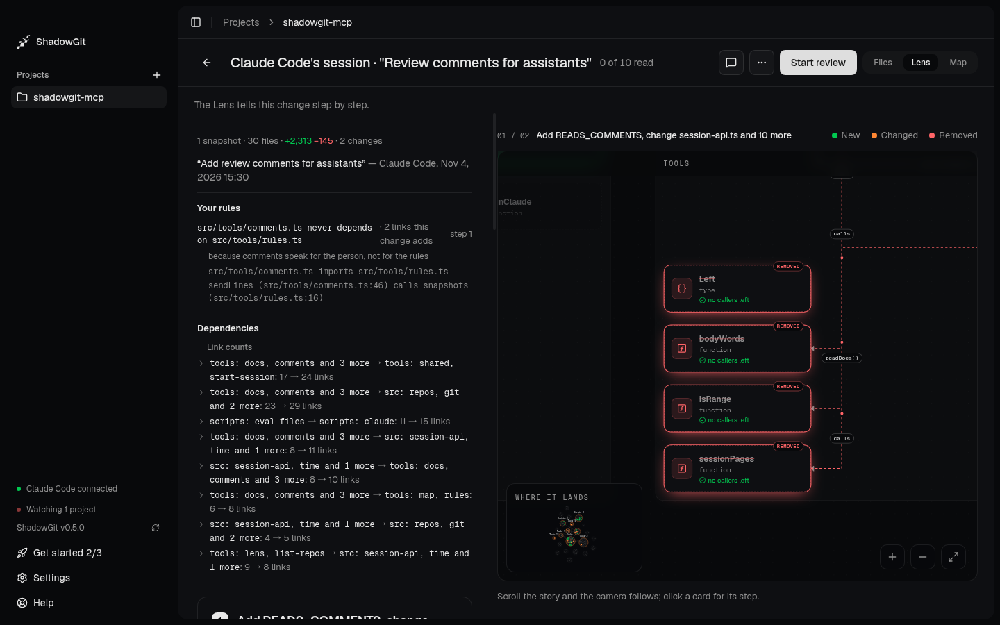
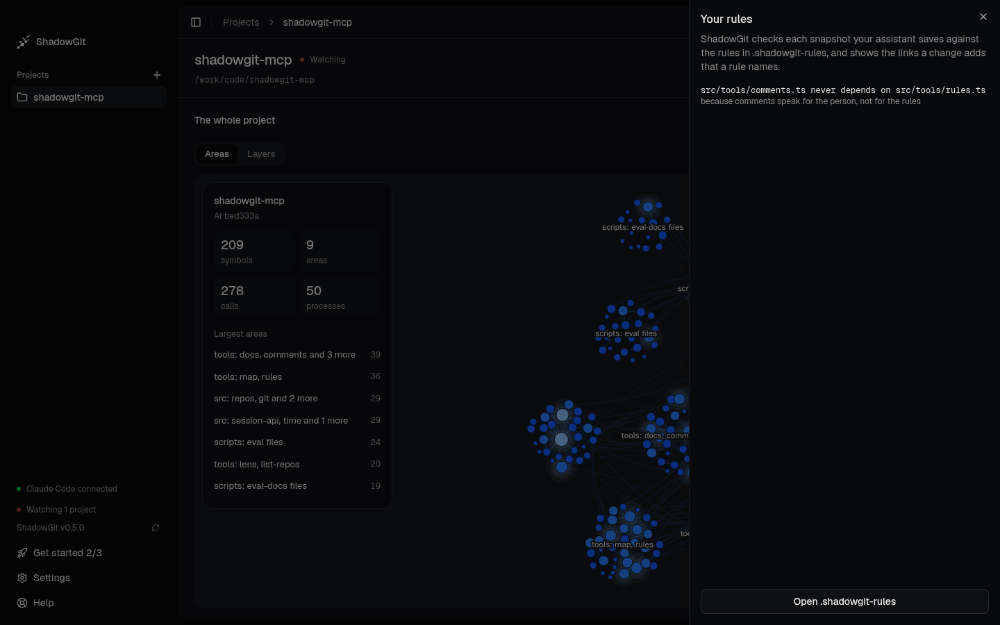

You write your project's architecture rules in one plain file, `.shadowgit-rules`, such as "src/jobs never depends on src/api". ShadowGit checks each snapshot your assistant saves against them, and shows the links a change adds that one of your rules names: in the [Lens](/lens), on the [Map](/map) and in your assistant's answers. The judgement is yours, in the rule. ShadowGit states the link and quotes your rule. Rules need ShadowGit 0.3.11 or later. This page shows them in ShadowGit after 0.4.0.

<Frame caption="The Lens of Claude Code's session: your rule, its reason, and the two links the session adds that it names">
  
</Frame>

## Write your rules

`.shadowgit-rules` sits at your project's root, beside `.shadowgit-ignore`. It holds one rule a line, and skips lines that start with `#` and blank lines:

```text .shadowgit-rules
# The webshop's boundaries, one rule a line.
src/jobs never depends on src/api because jobs read the database through src/db
only src/lib/supabase depends on @supabase/supabase-js because the client is built there
nothing depends on lodash because the standard library covers it
```

You can write it yourself, or ask your assistant to. Keep it in your own git with your code if you like, so your team and their assistants work to the same rules.

To start one from the app, open the command palette (`⌘K`), pick **Your rules…**, then **Write rules**. ShadowGit creates the file with a commented example, and **Open .shadowgit-rules** opens it in your editor. Once the file exists, **Rules**, at the top right of the map in Project and in Review, opens the same panel. The panel and **Your rules…** need ShadowGit after 0.4.0.

ShadowGit reads the file from your project's folder each time it checks, so a rule you wrote a minute ago applies.

## The three forms

| Rule | Names a link |
|---|---|
| `A never depends on B` | from code under A to code under B |
| `only A depends on B` | into B, from code outside both A and B |
| `nothing depends on B` | into B, from code outside B |

- A side can list several names, separated by commas: `src/ui, src/jobs never depend on src/db`. Both "depend" and "depends" read.
- `because …` at the end gives your reason. It's shown with every link the rule names.

## Names

- **A path** is relative to your project's root, written with `/`. It covers the file or folder it names and everything under it, by whole folder names: `src/ui` covers `src/ui/cart.ts`, but not `src/uikit`.
- **One of your project's own packages**, such as `@acme/ui` in a monorepo, stands for that package's folder.
- **Any other name is a package**, such as `lodash`, which covers `lodash/fp` too. Package imports are checked in JavaScript and TypeScript files. Folder rules hold in every language the Lens reads.

A name that is no file or folder of your project, and none of its own packages, reads as a package. The Map's **Rules** panel lists those names, so a mistyped folder, such as `src/dbs`, shows.

## What a rule names

A rule names the links a change **adds**, not the ones your project already has. A rule you write today doesn't flag older code.

- **An import makes a link:** an import as written, a named import followed through files that only pass names on, an import of types ("imports types from"), and an import of a package.
- **Calls and `extends`** between the same two files are listed with the import, but a call alone, with no import behind it, never makes a link.
- **Links within one side don't count.** Under `src never depends on src/db`, a file in `src/db` that imports another one isn't named.
- **Code the Map leaves out isn't counted,** such as test files.

At most 100 rules and 64 KB of the file are read. A line that isn't a rule is skipped, and the **Rules** panel names it by its number, with what a rule looks like. ShadowGit reads `.shadowgit-rules` only as a plain file: a link or a folder of that name isn't read, and the Lens says "Your rules weren't checked" and why.

## Where you see them

### In the Lens

**Your rules** sits under the summary, before [Dependencies](/lens#dependencies). For each rule that names a link the change adds, it shows the rule, your reason, how many links and the first five of them, and the steps that hold them. A quiet line covers the others, the rules that name no link the change adds. Each step that holds such a link says "adds a link your rule names", with the rule.

A change that edits `.shadowgit-rules` says so, with the rules it adds and removes. This shows even when the change touches no code, so a rule your assistant deleted always shows.

Every change is checked when the project has rules, your own snapshots included.

### On the Map

**Where it lands** lists the same lines for the change it shows. **Rules**, at the top right of the Map, in Project or in Review, opens your rules as ShadowGit reads them: each rule with its reason, the lines read as no rule, and the names read as packages. The panel reads the file again when ShadowGit's window gains focus, so an edit you made in your editor shows.

<Frame caption="The Your rules panel: a rule as ShadowGit reads it, with its reason">
  
</Frame>

### In your assistant

Through the [ShadowGit MCP server](/installation), your assistant reads the rules that hold for the files it's about to change before its first edit, and works in a session. When it saves a snapshot, ShadowGit checks the session against your rules, and the answer lists each link a rule names, with the rule and your reason. Your assistant is asked to take such a link out, or to tell you why it's there.

The check never refuses or holds back a saved snapshot: ShadowGit saves it first, then checks. A check that takes longer than 45 seconds goes on, and the Lens shows it when it's done.

## Privacy

ShadowGit reads your rules on your computer. Its usage data counts each check of a saved snapshot (its outcome, how many rules and how many named a link) and a rules file created from the panel, never a rule, a path or a package. What your assistant reads goes to your AI provider, like any file it opens.

A project you cloned may come with a `.shadowgit-rules` its authors wrote. Your assistant reads each rule as what the file says, and keeps to the links it names.

## Requirements

Your rules need ShadowGit 0.3.11 or later. Your assistant hears them with version 2.5.0 or later of the [MCP server](/installation).
